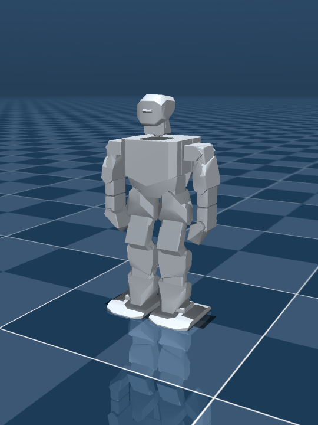

# TonyPi Pro — estimated 3D model

**Version label: Opus5.5** (built with Claude Opus 5.5). Interactive viewer: https://tonypi-pro-model-opus55.netlify.app



This repository contains a **MuJoCo model candidate** for a Hiwonder TonyPi Pro, the 37 cm, 1.8 kg Raspberry Pi humanoid. It is built the same way as the Luka A2 Ultra twin: a pinned public vendor model supplies the structure, meshes and contact geometry, and a parameter ledger supplies every frame, axis, limit, servo gain, joint dynamics value and inertial. Solver options, contact friction, collision shapes and sensor sites stay as the vendor file has them. The render above is generated from the model. It is **not** a 3D scan of a TonyPi Pro, and it has not been validated against a physical unit.

Open [`build/tonypi_pro_as_is.xml`](build/tonypi_pro_as_is.xml) in MuJoCo to load the assembled fixed-base model. Keep the `build/` and `vendor/tonypi/` directories in their current relative positions: the XML references the mesh files there.

## Put the TonyPi Pro in a simulator

Start with the [MuJoCo simulation guide](sim/README.md). It covers:

- a separate [floating-base, floor-contact scene](build/tonypi_pro_contact_candidate.xml) that stands under its own servos;
- a fixed-base training-pipeline environment;
- playback of Hiwonder `.d6a` action groups on either scene.

Run the software integration check from this repo's root:

```sh
.venv/bin/python -I sim/check_integration.py
```

The twin's 20 servos are position servos, like the robot's, so commanding zero holds the CAD home pose. On the floor it stands, waves and squats without falling. It also holds Hiwonder's stock standing crouch. None of this is a validated walking or balance controller, and the servo models are partly upstream estimates.

## NVIDIA Isaac Sim

See [the Isaac Sim guide](isaac_sim/README.md). A derived URDF carries the ledger's inertials, joints, limits and the vendor's collision primitives for Isaac Sim's URDF importer. An offline check compares that URDF with the MuJoCo twin. The guide also has Isaac Sim 6.2 import and smoke-run scripts and a GPU physics check with NVIDIA Newton.

## What is in this repository

- `build/tonypi_pro_as_is.xml` — the generated, readable fixed-base MuJoCo model. MuJoCo's XML writer rounds its numbers to about six significant figures.
- `build/tonypi_pro_as_is.report.md` — build status, the upstream labels on vendor values, Hiwonder cross-checks, gaps and the part-mass breakdown.
- `build/tonypi_pro_contact_candidate.xml` — the floating-base scene with the vendor's floor and its `home`, `prone` and `supine` keyframes.
- `vendor/tonypi/` — unchanged public model inputs from [`pab47/TonyPi`](https://github.com/pab47/TonyPi) at commit `97807f5`: robot and scene MJCF, 21 STL meshes, the MIT licence, provenance and SHA-256 checksums.
- `model/ledger.csv` — 628 parameter rows with units, source, date, evidence and active/missing status:
  - 597 vendor rows, each noting what the upstream file says about that number;
  - 29 rows from Hiwonder publications;
  - 2 missing values.
- `model/measurements.csv` — 16 ruler-and-scale measurements, with model and Hiwonder values and blank columns for your unit.
- `model/servo_map.csv` — maps bus and PWM channels to joints. It holds the upstream author's servo calibration and blank columns for your unit's.
- `model/build_twin.py` and `tools/` — scripts that seed the ledger, build, inspect and render the model, read action groups and write the manifest. `SOURCE_MANIFEST.json` records every shipped file's hash.
- `sim/` — the contact-scene builder, integration check, training environment, tuning demo, action playback and pose preview.
- `data/action-groups/` — two synthetic demonstration action groups with a manifest. They are not robot recordings: no data from your unit exists yet.
- `isaac_sim/` — URDF export, Isaac Sim import and smoke-run scripts, and the Newton check.

The upstream README says Salvador Echeveste built the vendor model from a STEP file supplied by Hiwonder. Pranav Bhounsule publishes it under the MIT licence; see [`vendor/tonypi/PROVENANCE.md`](vendor/tonypi/PROVENANCE.md). Hiwonder publishes no URDF or MJCF of its own. Hiwonder facts in the ledger cite the product page or datasheet they came from. Hiwonder's software and stock action groups carry no licence, so none are copied here.

## Current validation boundary

The checked XML compiles in MuJoCo 3.17.0 with 21 links, 20 hinge joints, 20 position servos, 45 sensors and a fixed base. The build uses 615 ledger values: 597 from the vendor file and 18 servo velocity limits from Hiwonder datasheets.

There are no estimates of our own. The vendor values themselves are a third-party reconstruction:

- 18 servo armature values are labelled ESTIMATE upstream.
- 40 servo gain values are simulation tuning, including upstream's `kp` 64 walking fix on the four roll joints.
- 22 friction and head-armature values have no stated basis.
- The two hand servos have no velocity limit, because Hiwonder does not publish their model.

Software checks run on this machine:

- **Vendor equivalence:** over 2 s, the ledger-built twin reproduces the vendor model's own simulation within 3e-9 rad with a fixed base and 8e-7 rad on the floor.
- **Rebuild:** rebuilding from the ledger gives a byte-identical XML.
- **Datasheets:** the vendor's servo torque caps match Hiwonder's LX-824HV and LFD-01M datasheets within 0.3%, and its torque-speed damping within 0.35%.
- **Mass:** the model's 1.800 kg matches Hiwonder's "about 1800 g" figure, which may exclude the Pro hands.

The CAD hulls span about 387 × 206 × 120 mm in the home pose, against Hiwonder's 373 × 186 × 106 mm. These are software and model observations, not verified properties of any particular robot. No TonyPi Pro has been measured, weighed or replayed against this twin.

The generated 4.5 MB `.mjb` is not shipped. It can be rebuilt from the ledger and vendor files. The binary keeps the ledger's full precision, while the XML is rounded.

## Load and rebuild

The pinned requirements need **Python 3.12 or newer**. On a Mac, from the repository root:

```sh
python3.12 -m venv .venv
.venv/bin/python -m pip install -r requirements-sim.txt
.venv/bin/python -I tools/mj_inspect.py build/tonypi_pro_as_is.xml
.venv/bin/python -I model/build_twin.py --out build/rebuilt.xml
```

On Windows PowerShell, use `.venv\Scripts\python.exe` in place of `.venv/bin/python` (with [uv](https://docs.astral.sh/uv/): `uv venv --python 3.12` then `uv pip install -r requirements-sim.txt`). The preview render can differ by a few pixels between GPUs and drivers, so it is regenerated rather than byte-checked. The full rebuild runs these steps in order:

```sh
.venv/bin/python -I tools/seed_ledger.py          # merge-only: adds rows, never changes existing ones
.venv/bin/python -I model/build_twin.py           # ledger + vendor -> build/tonypi_pro_as_is.xml, .mjb, report
.venv/bin/python -I tools/make_manifest.py        # record hashes before deriving
.venv/bin/python -I sim/build_contact_scene.py    # floating-base scene from the checked baseline
.venv/bin/python -I tools/render_preview.py       # media/preview.png
.venv/bin/python -I tools/make_manifest.py
```

To check the byte-preserved vendor input files:

```sh
cd vendor/tonypi
shasum -a 256 -c SHA256SUMS
```

## Servo IDs and calibration

Hiwonder's 20-DOF ID diagram and stock action groups put bus servos 1–8 on the robot's left: ankle roll, ankle pitch, knee, hip pitch, hip roll, elbow, shoulder roll, shoulder pitch. Servos 9–16 are the same joints on the right. The right hand is ID 17 and the left hand ID 18, per Hiwonder's code. The head uses PWM servos: channel 1 tilts and channel 2 pans. The vendor XML's actuator comments reverse the left and right numbers. `model/servo_map.csv` follows Hiwonder and records the conflict.

Converting an action group's pulses to joint angles needs each servo's zero pulse and mounting sign. The map carries the upstream author's measured values as a **reference** calibration. Columns for your unit are blank, and `sim/play_action.py --calibration unit` refuses until they are filled. Decoded with the reference values, Hiwonder's stock stand pose gives a left/right-symmetric crouch: knees bent 61–63°, hips −44°, soles level. The floating twin holds it. That checks the ID pairing and the leg pitch-chain signs: a one-sided sign error or a swapped pitch joint fails. It cannot tell IDs 1–8 from 9–16 (a left/right swap passes) or catch a sign error shared by both sides on the roll, shoulder or elbow servos; that side assignment rests on Hiwonder's diagram and action files. It does not calibrate your robot.

## Make it match your robot

1. Weigh the robot, and fill `model/measurements.csv` with a ruler and caliper.
2. Read each servo's pulse with the robot in the model's zero pose: straight legs, arms down, head level. Enter the pulse in `unit_zero_pulse` and the direction in `unit_sign` in `model/servo_map.csv`.
3. Add measured values to `model/ledger.csv` as `measured-on-unit` rows for the same parameter names. Mark the vendor row they replace as `deprecated`, then rebuild; the build refuses unknown parameter names and deprecated rows without a replacement. Once you do, `sim/check_integration.py` reports vendor equivalence as not applicable. Sole and collision geometry (M08, M12–M14, M16) are not ledger parameters yet.
4. Replay the same stock action on the robot and on the twin, and compare them joint by joint.

The A2 twin was built from AgiBot's own model of its robot. This one starts from an independent reconstruction, and the TonyPi Pro's servos take position commands rather than torques. All 20 of its joints have actuators; the A2 model had 16 unactuated arm and head joints.
